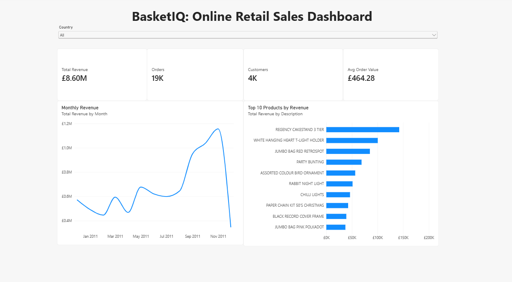

# BasketIQ: Online Retail Sales Analysis

A data analysis project using a year of real transactions from a UK online gift retailer.

**Tools:** Python (Pandas) · SQL (SQLite) · Power BI

---

## The Question
What drives revenue for this business: **when** do customers buy, **what** do they buy, and **which customers** matter most?

## The Data
[Online Retail II](https://archive.ics.uci.edu/dataset/502/online+retail+ii) from the UCI Machine Learning Repository. I used the Dec 2010 – Dec 2011 data: **541,910 transactions**.

---

## Step 1: Cleaning the Data (Python)
| What I removed | Rows | Why |
|---|---|---|
| Cancelled orders | 9,288 | Not real sales |
| Zero or negative quantity/price | 2,517 | Errors and adjustments |
| Missing Customer ID | 132,220 | Needed for customer analysis |
| Duplicate rows | 5,192 | Counted twice |
| Anomalous orders | 3 | See below |

**Final dataset:** 392,690 clean rows

### Anomalies I Found
Two products showed suspiciously high sales. When I investigated, I found **3 orders that added £285k of fake revenue**:

- **80,995 units** of one product in a single order, cancelled the same day
- **74,215 units** of another, also cancelled (the next-biggest order was only 4,800)
- **60 picnic baskets at £649.50**, re-ordered as 1 basket five minutes later, which looks like a typo

**Lesson:** removing the cancellation lines wasn't enough. The original orders had to go too.

---
## Step 2: Analysis (SQL)

I loaded the clean data into SQLite and wrote queries using **aggregations, CTEs and window functions** to find trends, top products, top countries and customer patterns.

## Step 3: Dashboard (Power BI)

An interactive dashboard containing:
- KPI cards (revenue, orders, customers, average order value) built with **DAX measures**
- a monthly revenue trend
- the top 10 products by revenue
- a country filter that updates every chart

---

## Key Findings

1. **£8.6M revenue** from 18,529 orders and 4,337 customers. The average order is **£464**, which suggests many customers are wholesalers.
2. **Q4 is huge.** November revenue was **2.6× February's**, and Sep–Nov made up **36.5%** of the year.
3. **Repeat customers drive the business.** **66%** of customers came back, and they brought in **94% of revenue**.
4. **A few customers matter a lot.** The **top 10%** of customers generated **60% of revenue**.
5. **Mostly UK.** The UK is **81%** of revenue. Ireland is third, but almost all of it comes from just **3 big customers**.

## Limitations

- 25% of rows had no Customer ID, so the customer figures cover about 75% of sales.
- December 2011 only covers 9 days, so its low number isn't a real drop.

---

## Files

- `BasketIQ_cleaning.ipynb`: Python cleaning and SQL queries
- `BasketIQ.pbix`: Power BI dashboard
- `dashboard.png`: dashboard screenshot
